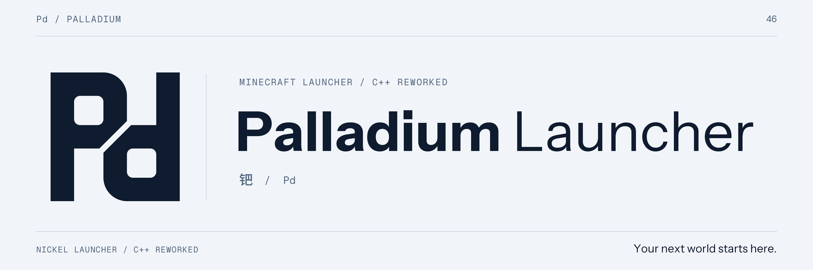

<picture>
  <source media="(prefers-color-scheme: dark)" srcset="native/assets/brand/banners/palladium-launcher-hero-dark.png">
  <source media="(prefers-color-scheme: light)" srcset="native/assets/brand/banners/palladium-launcher-hero-light.png">
  
</picture>

<div align="center">

# Palladium · Pd · 钯

**把准备交给 Pd，把时间留给你的世界。**

Minecraft Java 版启动器 · C++20 / Qt 6 原生实现

[](native/metadata.json)
[](https://github.com/Nickel-Studio/Pd-Launcher/actions/workflows/build.yml)
[](LICENSE)
[](LICENSE-ASSETS)

[原生文档](native/README.md) · [使用指南](docs/native/user-guide.md) · [参与开发](CONTRIBUTING.md) · [反馈问题](https://github.com/Nickel-Studio/Pd-Launcher/issues)

</div>

---

## 这是什么

Palladium（Pd / 钯）是 Minecraft Java 版启动器。界面用 C++20 与 Qt 6 Widgets 自绘，不依赖内嵌浏览器；账号、实例、下载与启动准备都在启动器内完成，Java、Minecraft 和各类加载器作为独立进程运行。

# Palladium正在早期开发阶段，此时使用你将遇到大量的BUG（例如动画化覆盖度几乎为0，如同滚木般的UI等），在早期开发阶段结束前建议使用更成熟的[Nickel](https://github.com/Nickel-Studio/Ni-Launcher)作为替代品。

## 主要特性

- **世界各有位置** — 多个游戏目录与独立实例；Java、内存、窗口和启动参数可以跟随全局，也可以为单个实例覆盖。改名不会移动实例目录。
- **从原版到 Mod** — 安装原版与 Forge、NeoForge、Fabric、OptiFine、LiteLoader；在 Modrinth 与 CurseForge 中检索 Mod、整合包、光影和资源包。
- **换个身份** — 微软正版、LittleSkin 等 Yggdrasil 皮肤站和离线账号；保存多个账号并在首页切换。
- **下载不打断操作** — 版本、文件和社区资源分别选择来源，统一排队、取消与镜像回退，线程数和限速可调。
- **外观与排障** — 明暗模式独立于 12 个颜色主题，可放自己的背景；导出标准 `.mrpack`，或带启动器、外观与实例设置的便携 ZIP；启动失败时能看退出原因并打开日志。

操作细节、数据位置与常见问题见 [使用指南](docs/native/user-guide.md)。

## 平台现状

| 平台        | 现状                                                                                                         |
| ----------- | ------------------------------------------------------------------------------------------------------------ |
| Windows x64 | 可以完整构建（UI 与测试），构建和 CTest 均通过，并产出单文件 `pd-launcher.exe`。尚未签名，未在干净机器验证。 |
| Linux x64   | 核心业务域可以构建并通过测试；图形界面（Qt Widgets）尚未在 Linux 上构建。                                    |
| macOS       | 尚未在真机验证，没有可用的编译、测试或部署结果。                                                             |

当前没有正式发行版本。上面的结果来自开发者机器，不是发布承诺，也不代表其他机器或依赖版本同样可用。

## 构建与运行

依赖：

| 项目    | 要求                                                         |
| ------- | ------------------------------------------------------------ |
| C++     | C++20                                                        |
| 构建    | CMake 3.25+、Ninja                                           |
| Qt      | 6.8.3，Core / Gui / Widgets / Svg；UI 测试另需 Qt6::Test     |
| Python  | 3.12+；脚本以 `python -B` 运行，不写 `__pycache__`           |
| Windows | MSVC x64 + Windows SDK；生产 CRT 与依赖统一 `/MT`，静态 Qt   |
| Linux   | GCC/Clang、线程库、静态 OpenSSL；图形会话另需 XCB 等系统依赖 |
| macOS   | 匹配架构的 Apple host；交付脚本使用 Xcode 16.4 / SDK 15.5    |

第三方依赖由 `scripts/native/deps-lock.json` 锁定版本与 SHA256，`scripts/native/bootstrap-deps.py` 按锁供应并校验；换成系统 Qt 或其他版本后，构建结果与仓库里的记录不再对应。

### 先确认工具链

Windows 上 `scripts/native/msvc.py` 会读取已安装的 Visual Studio 开发环境，把 VS 自带的 CMake / Ninja 补进本次命令：

```powershell
python -B scripts/native/msvc.py -- cmake --version
python -B scripts/native/msvc.py -- cmake --list-presets
```

`CMakePresets.json` 提供两个 preset：`native-release`（完整 UI + 测试）与 `native-core`（只构建纯 C++ 域）。preset 的构建目录放在 `.snow/` 下，只适合本机试跑；要做可分发的构建，请显式指定源码树之外的目录。

### 测试构建（Windows）

`$prefix` 换成真实的静态依赖前缀，`$oracle` 必须指向包含 `src/assets/` 与 `tests/brand/functional-icons.sha256` 的完整 checkout，否则品牌测试会在配置阶段直接失败。

```powershell
$prefix = 'D:/pd-tools/install/windows-x64-static'
$oracle = (Resolve-Path .).Path

python -B scripts/native/msvc.py -- cmake -S . -B build/native-windows-tests -G Ninja -DCMAKE_BUILD_TYPE=Release "-DCMAKE_PREFIX_PATH=$prefix" "-DASSET_ORACLE_ROOT=$oracle" -DNICKEL_SHARED_NATIVE_ROOT= -DCMAKE_MSVC_RUNTIME_LIBRARY=MultiThreaded -DNICKEL_BUILD_UI=ON -DNICKEL_BUILD_TESTS=ON -DNICKEL_ENABLE_IPO=OFF
python -B scripts/native/msvc.py -- cmake --build build/native-windows-tests --parallel 4
python -B scripts/native/msvc.py -- ctest --test-dir build/native-windows-tests --no-tests=error --output-on-failure
```

`-DNICKEL_SHARED_NATIVE_ROOT=` 必须显式留空。共享工作区里存在 `.snow/native-shared/snapshot.json` 时，配置会自动指向别人的源码快照，那不是一个自包含构建。

### 生产构建（Windows）

测试构建不允许 `cmake --install`，单文件产物要从单独的 `TESTS=OFF` 目录出：

```powershell
python -B scripts/native/msvc.py -- cmake -S . -B build/native-windows-prod -G Ninja -DCMAKE_BUILD_TYPE=Release "-DCMAKE_PREFIX_PATH=$prefix" -DNICKEL_SHARED_NATIVE_ROOT= -DCMAKE_MSVC_RUNTIME_LIBRARY=MultiThreaded -DNICKEL_BUILD_UI=ON -DNICKEL_BUILD_TESTS=OFF -DNICKEL_ENABLE_IPO=OFF
python -B scripts/native/msvc.py -- cmake --build build/native-windows-prod --target ni-launcher --parallel 1
```

产物是 `pd-launcher.exe`，位于构建目录的 `native/app/` 下，名称取自 `native/metadata.json`。CMake target 内部仍叫 `ni-launcher`，这是为了兼容既有脚本和构建记录。

```powershell
& ./build/native-windows-prod/native/app/pd-launcher.exe
```

Linux 与 macOS 的参数、依赖供应步骤和已知限制见 [原生开发指南](docs/native/development.md)。

## 目录结构

```text
cmake/              构建辅助模块：依赖、域注册、Qt 配置、生产 smoke
native/core/        纯 C++ 业务域：config、network、accounts、instances、resources、minecraft
native/app/         应用层：启动编排、动作管线、服务装配、通知资源
native/ui/          Qt Widgets 视图、页面与自绘组件
native/platform/    平台适配（进程、Java、内存、GPU 偏好）
native/assets/      品牌素材、图标与 QRC 资源清单
native/tests/       域测试与组件测试
tests/native-*      原生验收与工具脚本
docs/native/        原生使用、开发、接口与发布文档
scripts/native/     依赖供应、构建包装、许可校验与打包脚本
src/assets/         功能图标与加载器图标等静态素材
website/            官网静态页面
LICENSES/           第三方许可原文与依赖声明
.github/workflows/  构建验证（Windows/Linux）、macOS 交付与官网部署工作流
```

## 文档

| 文档                                                                 | 内容                                       |
| -------------------------------------------------------------------- | ------------------------------------------ |
| [native/README.md](native/README.md)                                 | 原生版入口：平台现状、构建边界与源码约定   |
| [docs/native/user-guide.md](docs/native/user-guide.md)               | 使用指南：启动、账号、实例、数据位置与恢复 |
| [docs/native/development.md](docs/native/development.md)             | 开发与构建：工具链、依赖供应、测试与部署   |
| [docs/native/interfaces.md](docs/native/interfaces.md)               | 域接口、DTO 与数据兼容约定                 |
| [docs/native/release-checklist.md](docs/native/release-checklist.md) | 发布前逐项检查清单                         |
| [docs/architecture.md](docs/architecture.md)                         | 原生分层、业务域与数据兼容                 |
| [docs/cpp-rewrite-plan.md](docs/cpp-rewrite-plan.md)                 | 原生实现目标与兼容契约                     |
| [NOTICE.md](NOTICE.md)                                               | 第三方代码、字体、纹理与标识的许可归属     |

## 参与贡献

一个清晰的复现、一张交互草图、一处细节修复，都是有价值的贡献。改动前先读 [原生入口](native/README.md) 与 [接口约定](docs/native/interfaces.md)，提交前至少跑通对应域的 CTest；涉及界面时附上明暗两种模式的截图。

流程与代码约定见 [贡献指南](CONTRIBUTING.md)，问题反馈走 [Issues](https://github.com/Nickel-Studio/Pd-Launcher/issues)。

## 许可与资源

- 程序代码与项目文档采用 **[AGPL-3.0-only](LICENSE)**。
- Palladium 品牌与美术采用 **[CC-BY-SA-4.0](LICENSE-ASSETS)**，署名 Nickel Studio（ItzArona、ItzPlana）；品牌包内的原始来源与授权记录见 [NOTICE.txt](native/assets/brand/NOTICE.txt)。
- 功能图标、游戏纹理与第三方标识按各自权利保留，范围见 [NOTICE.md](NOTICE.md)。
- 第三方代码、字体、游戏纹理与外部标识按各自许可保留，归属与原文列在 [NOTICE.md](NOTICE.md) 与 [LICENSES/](LICENSES/)。

## 致谢

- 所有提交问题、测试与代码的贡献者。

<div align="center">

**Pd / 46 · Nickel Studio**

</div>
