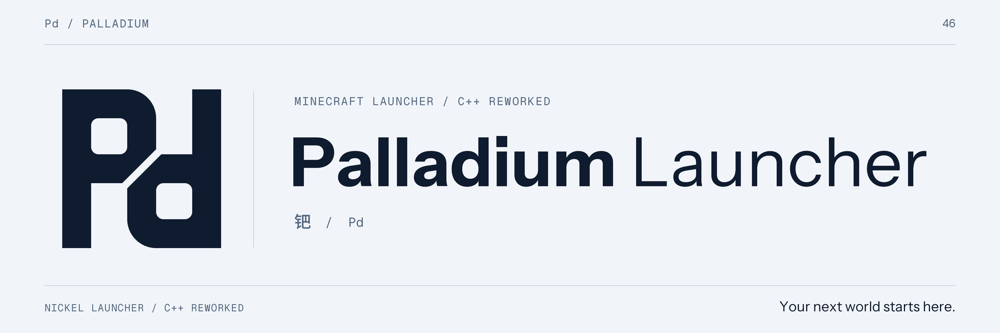

<picture>
  <source media="(prefers-color-scheme: dark)" srcset="assets/brand/banners/palladium-launcher-hero-dark.png" />
  <source media="(prefers-color-scheme: light)" srcset="assets/brand/banners/palladium-launcher-hero-light.png" />
  
</picture>

# Palladium 原生版

这里是 Palladium 原生版的说明入口。产品简介、特性与整体构建入口见根 [README](../README.md)。

## 平台现状

| 平台        | 现状                                                                                                         |
| ----------- | ------------------------------------------------------------------------------------------------------------ |
| Windows x64 | 可以完整构建（UI 与测试），构建和 CTest 均通过，并产出单文件 `pd-launcher.exe`。尚未签名，未在干净机器验证。 |
| Linux x64   | 核心业务域可以构建并通过测试；图形界面（Qt Widgets）尚未在 Linux 上构建。                                    |
| macOS       | 尚未在真机验证：没有编译、测试、部署或签名结果。                                                             |

这不是发行说明。当前没有正式发布版本；上表来自开发者机器，不代表其他机器或依赖版本同样可用。

## 构建与测试

工具链、依赖供应和逐平台参数见 [原生开发指南](../docs/native/development.md)。根目录提供两个 CMake preset：

- `native-release`：完整 UI 与测试。
- `native-core`：只构建纯 C++ 业务域。

```powershell
python -B scripts/native/msvc.py -- cmake --list-presets
```

构建时注意：

- `NICKEL_BUILD_TESTS=ON` 需要绝对路径的 `ASSET_ORACLE_ROOT`，且该 checkout 必须包含 `src/assets/` 与 `tests/brand/functional-icons.sha256`。
- 工作区存在 `.snow/native-shared/snapshot.json` 时，配置会改用共享源码；自包含构建请显式传 `-DNICKEL_SHARED_NATIVE_ROOT=`。
- 测试构建不能执行 `cmake --install`；单文件产物从单独的 `TESTS=OFF` 目录生成。

## 源码约定

- C++20 / CMake 3.25+ / Qt 6.8.3 Widgets + 自绘。不使用 WebView、WebEngine、QML/Quick、JavaScript 运行时或 Rust 业务侧车。
- 应用 CMake target 名为 `ni-launcher`，输出文件名取自 `native/metadata.json` 的 `executableName`（当前为 `pd-launcher`）。
- Windows 生产构建要求静态 Qt、`/MT` 运行时与静态传递依赖闭合；Linux 使用与目标系统匹配的原生依赖部署。
- 内部 `nickel` 命名空间、`NICKEL_*` 构建选项、`studio.nickel.launcher` 应用标识、`nickel.portable.json` 与 schema 1 数据格式保持兼容；改名不迁移数据目录。

## 美术与横幅

README 的亮暗横幅来自 [assets/brand/banners/](assets/brand/banners/) 下的 `palladium-launcher-hero-*.png`（1800×600），仅用于文档展示，不进入桌面 QRC。请勿裁切、滤镜或重绘；横幅上的 46 是钯的原子序数，不是版本号。品牌美术采用 [CC-BY-SA-4.0](../LICENSE-ASSETS)，署名与来源记录见 [NOTICE.txt](assets/brand/NOTICE.txt)。

## 文档

- [使用指南](../docs/native/user-guide.md)：启动、账号、实例、数据位置与恢复。
- [开发与构建](../docs/native/development.md)：工具链、依赖供应、测试与部署。
- [接口与数据约定](../docs/native/interfaces.md)：域职责、DTO 与兼容边界。
- [发布前检查清单](../docs/native/release-checklist.md)：发布前需要逐项确认的内容。
- [原生架构](../docs/architecture.md)：分层、业务域与数据兼容。
- [原生实现与兼容契约](../docs/cpp-rewrite-plan.md)：实现目标与兼容约定。
- [文档索引](../docs/native/README.md)。
